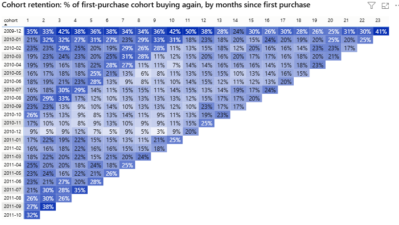
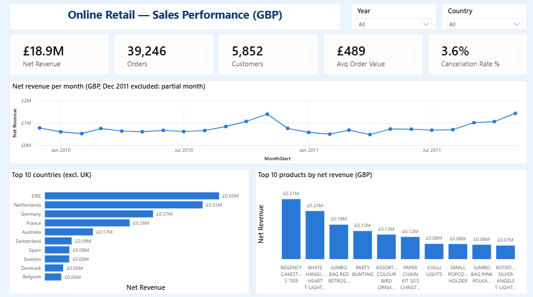
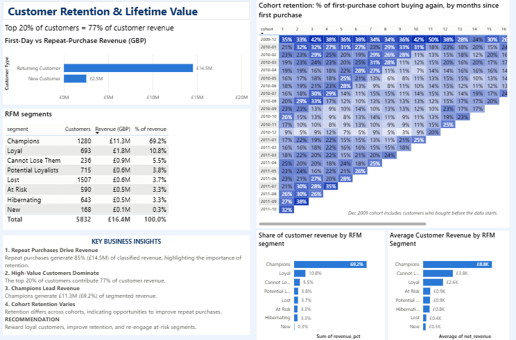

# Are New Customers Worth Acquiring? A Cohort Retention and CLV Study

A Python and Power BI analytics project exploring customer retention, cohort behaviour, RFM segmentation, and customer lifetime value (CLV) using two years of transactions from a UK-based online giftware wholesaler.

The goal is to understand whether new customers return, how customer value changes over time, and where the business should focus its retention efforts.
## Project at a Glance

**Business question:** How effectively does an online retailer retain newly acquired customers, and which customer segments contribute the most revenue?

**Approach:** Cleaned and analyzed two years of UK retail transactions using Python, performed cohort retention and RFM segmentation, and built a two-page Power BI dashboard.

**Key results:**
- Approximately 21% of new customers returned in month 1.
- The top 20% of identifiable customers contributed 77% of customer revenue.
- Champions generated approximately 69.2% of RFM-segmented revenue.
- Approximately £2.57M in net revenue was associated with transactions missing customer IDs, limiting customer-level analysis.

**Business takeaway:** Prioritize early customer retention, protect high-value customers, and test targeted reactivation campaigns.

**View the results:** [Open the two-page Power BI dashboard (PDF)](dashboard/dashboard.pdf)

## Project Objectives

- **Cohort Retention:** Measure how many new customers return after their first purchase.
- **Customer Lifetime Value (CLV):** Estimate historical customer value over 3-month and 12-month periods.
- **RFM Segmentation:** Group customers by recency, frequency, and monetary value.
- **Revenue Analysis:** Explore sales trends, seasonality, countries, and products.
- **Data Quality:** Document cleaning rules, missing values, cancellations, and reconciliation checks.
- **Business Recommendations:** Translate the analysis into practical customer-retention strategies.

## Tools and Technologies

- Python
- Pandas and NumPy
- Jupyter Notebook
- Matplotlib and Seaborn
- Power BI
- DAX
- Pytest
- Git and GitHub

## Dataset

**Source:** [Online Retail II — UCI Machine Learning Repository](https://archive.ics.uci.edu/dataset/502/online+retail+ii)

The dataset contains transactions from a UK-based online retailer, primarily selling giftware to wholesale customers.

| Attribute | Details |
|---|---|
| Period | 1 December 2009 – 9 December 2011 |
| Original records | 1,067,371 rows |
| Format | Excel workbook with two sheets |
| Currency | GBP |
| Customer identifier | Customer ID, which may be missing |

The raw dataset is not included in this repository. Download it from the UCI source and follow the setup instructions below.

## Project Structure

```text
retail-cohort-clv-analysis/
├── notebooks/
│   ├── 01_data_quality_overview.ipynb
│   ├── 02_retail_data_cleaning.ipynb
│   └── 03_cohort_retention_clv_analysis.ipynb
├── src/
│   ├── load_data.py
│   ├── clean_data.py
│   ├── analysis.py
│   └── __init__.py
├── reports/
│   ├── figures/
│   ├── tables/
│   ├── cleaning_log.md
│   └── data_quality.md
├── dashboard/
│   ├── online_retail.pbip
│   ├── online_retail.Report/
│   ├── online_retail.SemanticModel/
│   ├── dashboard.pdf
│   ├── measures.dax
│   └── theme.json
├── tests/
├── pytest.ini
├── requirements.txt
├── .gitignore
└── README.md
```

Generated data files are excluded from the repository because the processed Power BI exports are large. They can be created by running the notebooks.

## How to Run the Project

### 1. Download the dataset

Download the Online Retail II dataset from the [UCI dataset page](https://archive.ics.uci.edu/dataset/502/online+retail+ii).

Create the following folder structure in the project root and place the Excel workbook inside it:

```text
data/
└── raw/
    └── online_retail_II.xlsx
```

### 2. Set up Python

From the project root, run these commands in PowerShell:

```powershell
python -m venv venv
.\venv\Scripts\Activate.ps1
pip install -r requirements.txt
```

### 3. Run the notebooks in order

Open Jupyter Notebook and run these notebooks in sequence:

1. `notebooks/01_data_quality_overview.ipynb`
2. `notebooks/02_retail_data_cleaning.ipynb`
3. `notebooks/03_cohort_retention_clv_analysis.ipynb`

The notebooks load and inspect the data, clean transactions, perform the analysis, generate reports and figures, and prepare exports for the dashboard.

### 4. Open the Power BI dashboard

Open `dashboard/dashboard.pdf` to view the exported dashboard without Power BI Desktop.

To work with the Power BI project, open `dashboard/online_retail.pbip` in Power BI Desktop. The data source paths may need to be updated to match your local project folder, and the processed CSV exports must be generated first.

### 5. Run the tests

From the project root:

```powershell
python -m pytest
```

Some tests require the raw dataset and generated files. Tests that depend on unavailable data may be skipped.

## Analysis and Dashboard

The project investigates:

- Monthly revenue trends and seasonality
- Revenue contribution by country and product
- Cohort-based customer retention
- RFM customer segmentation
- Historical customer lifetime value
- Data cleaning and financial reconciliation

The Power BI dashboard includes two pages:

**Sales Overview:** Revenue trends, products, countries, and sales performance.

**Customers:** Retention, RFM segments, and customer value.
## Cohort Retention Analysis

The heatmap shows the percentage of customers from each acquisition cohort who returned in subsequent months. It helps identify early customer drop-off and differences in retention across cohorts.



## Power BI Dashboard

### Page 1: Sales Performance


### Page 2: Customer Retention & Lifetime Value


## Key Findings

The analysis of the cleaned Online Retail II dataset produced the following findings. The calculations are implemented in the project's Python notebooks and analysis functions.

- **Revenue growth:** Net revenue grew 2.3% between January–November 2010 and the same period in 2011.
- **Seasonality:** September–November accounted for 41% of January–November revenue.
- **Customer concentration:** The top 20% of customers contributed 77% of customer revenue.
- **Product concentration:** Approximately 22% of products generated 80% of product revenue.
- **Repeat purchases:** About 21% of new customers returned in month 1 and in month 3.
- **Customer value:** The reported average new-customer revenue was £634 over 3 months and £1,373 over 12 months.

These are historical findings from the dataset, not forecasts of future customer behaviour.

## Business Recommendations

The analysis highlights opportunities to improve customer retention, protect high-value customer relationships, and increase the effectiveness of marketing efforts.

### 1. Improve Early Customer Retention

**Finding:** Approximately 21% of newly acquired customers returned in month 1.

**Business action:** Introduce a structured post-purchase engagement program for first-time customers. Test personalized follow-up messages, product recommendations, and second-purchase incentives during the first month.

**How to measure success:** Track month-1 cohort retention, second-purchase conversion, and repeat-purchase revenue. Experiment with different follow-up timings rather than assuming a specific week is optimal.

### 2. Protect High-Value Customers

**Finding:** The top 20% of customers contributed approximately 77% of identifiable customer revenue.

**Business action:** Prioritize relationship management for high-value customers through personalized service, loyalty benefits, and proactive engagement.

**How to measure success:** Monitor repeat-purchase frequency, revenue retention, and changes in spending among high-value customers.

### 3. Reactivate At-Risk Customers

**Finding:** RFM segmentation identifies customer groups with different purchasing patterns, including at-risk and inactive customers.

**Business action:** Create targeted reactivation campaigns for customers whose purchasing activity has declined. Tailor offers based on previous purchasing behavior and test them against a control group.

**How to measure success:** Track reactivation rate, incremental revenue, and campaign return on investment.

### 4. Plan Inventory Around Seasonal Demand

**Finding:** September–November contributed approximately 41% of January–November revenue.

**Business action:** Prepare inventory, staffing, and promotional plans ahead of historically strong sales months. Investigate whether demand patterns differ by product and country.

**How to measure success:** Monitor stock availability, monthly sales performance, and seasonal forecast accuracy.

### 5. Prioritize High-Contributing Products

**Finding:** Approximately 22% of products generated 80% of product revenue.

**Business action:** Prioritize availability and merchandising for high-revenue products while evaluating lower-performing products for optimization.

**How to measure success:** Track product revenue, inventory availability, and contribution margins once cost data becomes available.

**Important:** These recommendations are proposed strategies based on historical transaction patterns. Their effectiveness should be validated through controlled experiments and ongoing KPI monitoring.

## Data Quality

The original analysis reports:

- 40,355 rows removed during cleaning, approximately 3.8% of the original records.
- A 3.6% cancellation rate when considering product transactions.
- Missing Customer IDs associated with approximately 14% of net revenue.

The cleaning process also considers duplicate records, overlapping dates between sheets, non-product transaction codes, invalid prices, cancellations, and incomplete customer identifiers.

See `reports/data_quality.md` and `reports/cleaning_log.md` for further details.

## Limitations

- The dataset contains revenue information but not product costs or profit margins.
- The retailer primarily serves wholesale customers, so its customer behaviour may differ from consumer e-commerce.
- Missing Customer IDs limit customer-level analysis.
- December 2011 contains only partial-month data.
- CLV estimates are based on historical spending and should not be interpreted as guaranteed future revenue.
**12-month customer value methodology:** Historical customer value is calculated as average cumulative net revenue per customer over the first 12 calendar months, including the acquisition month. To avoid incomplete observation windows, the analysis includes only acquisition cohorts with 12 fully observable months. Later cohorts are excluded from the 12-month calculation. The 3-month and 12-month metrics therefore use different eligible customer populations and should not be interpreted as directly comparable forecasts. These values represent observed revenue, not predicted future customer lifetime value.

## Repository Contents

- **Notebooks:** Data loading, cleaning, and customer analysis
- **Source code:** Reusable Python functions
- **Reports:** Data-quality documentation, cleaning logs, tables, and figures
- **Dashboard:** Power BI project and PDF export
- **Tests:** Automated checks for the analysis pipeline

## Future Improvements

- Add customer acquisition cost data to estimate customer profitability.
- Compare retention strategies across customer segments.
- Develop predictive CLV models.
- Track cohort performance through an interactive dashboard.
